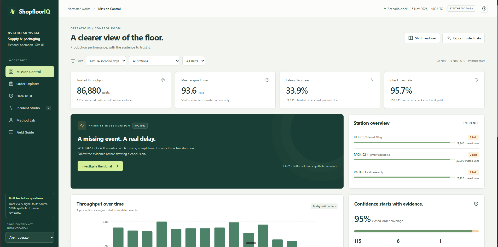
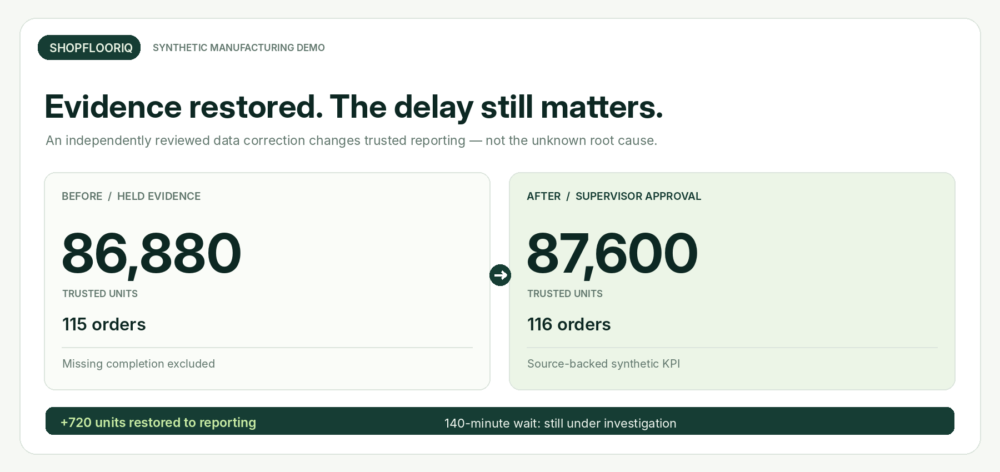
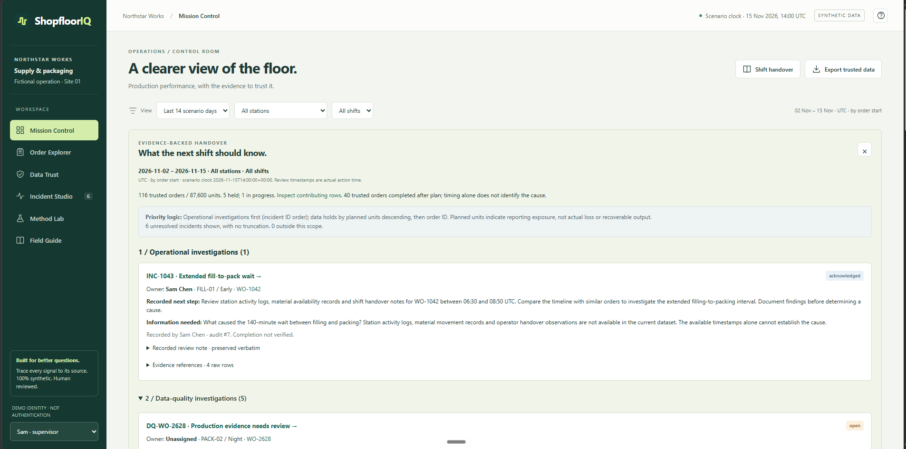
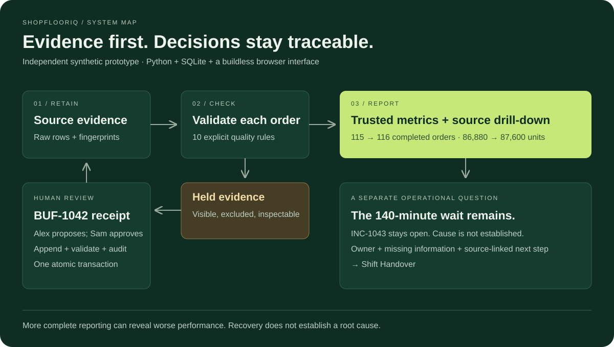

# ShopfloorIQ

**Manufacturing metrics you can trace back to evidence.**

An independent, local manufacturing intelligence prototype. Every organization, identity, order and source record is synthetic. No factory connection or company affiliation.



*Actual application, synthetic scenario. Browser chrome and the taskbar were cropped from the supplied capture. [Image provenance](docs/ASSET_PROVENANCE.md).*

[Run locally](#run-locally) · [Follow the case](#one-order-two-investigations) · [Explore the screenshots](assets/README.md) · [Inspect the engineering](#engineering-choices) · [Verification](ACCEPTANCE.md)

A missing completion event can make a finished order look eight hours old. Recovering that event can fix the report while leaving a real production delay unexplained. **ShopfloorIQ makes those two problems visible—and keeps their decisions separate.**

## One order. Two investigations.

**WO-1042** is held out of trusted reporting because its completion event is missing. A separate synthetic edge-buffer receipt, **BUF-1042**, supports **720 units completed at 09:10 UTC**. The observed **140-minute fill-to-pack interval** is a different investigation.

1. **Inspect the source.** The [held timeline](assets/portfolio/missing-event-timeline.png) shows start 06:00 → fill 06:30 → pack 08:50 → missing completion. The [receipt and impact preview](assets/portfolio/recovery-evidence.png) distinguish 480 minutes of apparent age from 190 minutes of supported elapsed time. Nothing has been applied yet.
2. **Propose a recovery.** [Operator Alex records the evidence and submits a proposal](assets/portfolio/operator-proposal.png). Reporting stays unchanged while approval is pending; the proposer cannot self-approve.
3. **Review independently.** [Supervisor Sam approves the receipt](assets/portfolio/supervisor-approval.png). Source append, validation and audit commit together. The [updated dashboard](assets/portfolio/dashboard-after.png) includes one more completed order. Approval precedes the separate action to resolve the data incident.
4. **Keep the operational question open.** INC-1042 can be resolved once the data is clear. INC-1043 retains the unexplained wait, an owner, missing information and an evidence-linked next step. A recorded plan is not a completed corrective action.



*Editorial comparison of readings visible in the application captures; this graphic is not an application screenshot.*

Default 2–15 November 2026 cohort, seed 1042:

| Metric | Before approval | After approval |
|---|---:|---:|
| Trusted completed units | 86,880 | **87,600** |
| Trusted completed orders | 115 | **116** |
| Supported elapsed time for WO-1042 | Unavailable while held | **190 min** |
| Held orders | 6 | **5** |
| Mean elapsed time | 93.6 min | **94.4 min** |
| Late-order share | 33.9% | **34.5%** |
| Closed-order evidence coverage | 95.0% | **95.9%** |

**This is a reporting correction, not increased production.** Late-order share rises because better evidence includes a previously excluded late order. [Reproducible measurements](docs/measured_results.json) · [Metric formulas](docs/metric_definitions.md)



*The next shift receives evidence and an investigation plan. INC-1043 remains acknowledged and unresolved; its cause is not established. [Reproduce the complete walkthrough](demo/hero_scenario.md).*

## Explore the product

- **Mission Control:** scoped KPIs, throughput, evidence coverage and complete shift handover.
- **Order Explorer:** search, held/validated/recovered timeline states and inspectable source rows.
- **Data Trust:** ten quality rules, quarantine, denominator reconciliation and idempotent imports.
- **Incident Studio:** evidence-specific investigations, independent recovery approval, revision checks and audit history.
- **Method Lab:** chronological rule/MAD comparison plus six conditions × five seeds exposing false alerts, misses and abstentions.
- **Field Guide:** operating guidance, metric definitions and local feedback.

## Run locally

Requires **Python 3.11+** and a modern browser. Verified locally on **Windows with Python 3.12.0**. No packages, build step, API key or cloud account are needed to run the app.

From the extracted repository root, with Python on PATH:

```sh
python -m scripts.recording
```

Open **http://127.0.0.1:8766**. Each launch creates a fresh, uniquely named synthetic SQLite database under `data/recordings/`. Existing sessions are preserved. Keep the terminal open; stop with Ctrl+C. If the port is occupied, append `--port 8767`.

On Windows, the launcher can also discover installed Python:

```powershell
.\Start-Recording.cmd
```

To resume a session, substitute its printed database path:

```sh
python -m shopflooriq serve --db data/recordings/your-session.sqlite --port 8766
```

No Linux/macOS execution is claimed locally. The prepared CI matrix targets Windows and Ubuntu; hosted runs have not occurred. [Operating guide and troubleshooting](docs/operator_quickstart.md)

## Engineering choices



*Implemented data and review flow. SQLite keeps evidence recovery, recalculation and the audit entry in one transaction.*

| Layer | Actual implementation | Why |
|---|---|---|
| Processing / HTTP | Python standard library | Small, inspectable local workflow with no runtime dependency installation |
| Persistence | SQLite, 13 tables | Atomic evidence recovery, durable review state and consistent analytical reads |
| Interface | Buildless HTML, CSS and JavaScript | Direct control over investigation navigation and evidence presentation |
| Detection | Fixed wait rule and station median/MAD | Explainable baselines with explicit sparse-data and zero-spread behavior |
| Verification | `unittest`, real HTTP tests, Node `node:test` | Exercise domain invariants, approval rollback, reconciliation and UI logic |

Raw rows have canonical fingerprints; imports reject conflicting row identities. Any blocking finding excludes the whole order from trusted KPIs. Supervisor self-approval is prohibited. A recovery cannot commit unless validation clears. Audit updates are blocked in normal application flows, **but filesystem access can still alter SQLite**. [Architecture and tradeoffs](docs/architecture.md)

## Verify

Developer checks also require **Git** and **Node.js 24** (locally verified: 24.19.0):

```sh
python -m scripts.verify
python -m scripts.audit_repository
python -m scripts.benchmark
```

**Last full verification, 16 November 2026: 144 tests passed locally—102 Python and 42 JavaScript.** This includes the original 133 application tests and 11 publication checks. Syntax and fresh CLI/HTTP startup also passed. [Exact results and boundaries](ACCEPTANCE.md) · [Machine-readable run](docs/verification_results.json)

The publication audit requires a Git checkout or a staged local index. It scans indexed content, reachable history and relative documentation targets. Detailed logs and disposable data stay in ignored `test-results/`. CI is [configured](.github/workflows/ci.yml), with no passing-status claim before its first hosted run.

## Read the repository

```text
shopflooriq/   source generation, quality, analytics, review commands, HTTP
web/          interface and interaction logic
tests/        domain, HTTP, UI logic and publication regression checks
scripts/      isolated rehearsal, verification, measurements, export audit
docs/         architecture, data dictionary, methods, metrics and limitations
demo/         reproducible case and recording storyboard
assets/       application screenshots, editorial comparison and architecture
```

Start with the [demonstration](demo/hero_scenario.md), [data model](docs/data_dictionary.md), [quality rules](docs/quality_and_governance.md) or [method evaluation](docs/ai_methods_evaluation.md).

**Boundaries:** selectable identities are not authentication; this is a loopback prototype, not a production service. Six planted positives do not establish factory accuracy. The stress protocol shows rare-deviation precision of **11.7%** and **1,000 low-sample abstentions**. Plans are intentions, not verified corrective actions. The supplied screenshots document visible states; they do not replace full browser/layout acceptance or final recording sign-off. [Full limitations](docs/limitations.md)

[MIT license](LICENSE) · [Contributing](CONTRIBUTING.md) · [Publication review](docs/repository_readiness.md). No deployment or video is published.
